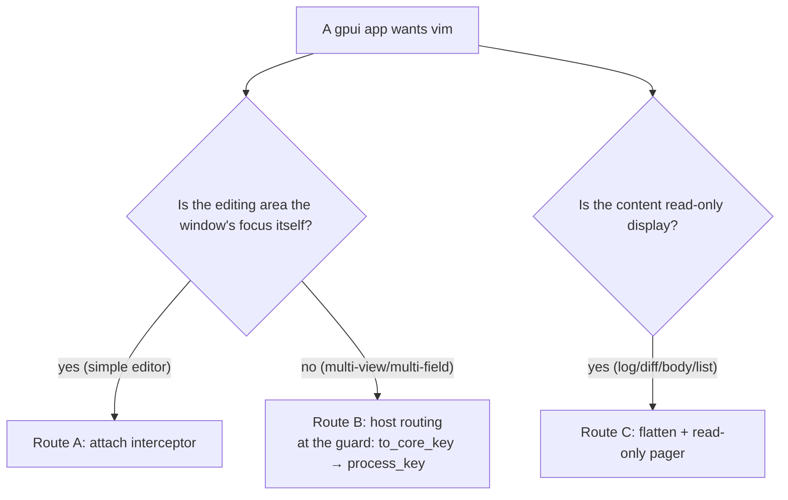

> **2026-09-28**: the pure engine has been split into its own repository [beyondlex/vimcore](https://github.com/beyondlex/vimcore) (crate name `vimcore`, formerly `gpui-vimcore`/`vimcore`). Where the rest of this document uses old names, read them as the current ones.

# Three-repo collaboration design: gpui_vim × PandaGit × PandaMail

> Basis: the practicality assessment in doc-poste `gpui-vim/assessment.mdx` (2026-09), plus two rounds of
> status inventory of the pandagit / pandamail repos. This document answers one question: **what does each of
> the three repos do next, in what order, and how is each step accepted**. The engine's internal semantic
> constraints are in ROADMAP "Global invariants" and not repeated here; every task in this document belongs to
> the "component layer", and the invariants must likewise be read first before starting.
>
> **Progress (2026-09-17)**: stage 0 (INTEGRATION.md three-mode decision document), stage 1
> (`gpui_vim::edit`, pandamail migrated to a thin facade), stage 2a (`gpui_vim::pager`,
> pandamail delegating), and P2's TCK (`vimcore::tck`, wired into both gpui-vim and pandagit; the TCK's first
> run caught PagerBuf's line_range missing the terminating `\n`, a contract violation) have all landed.
> Remaining: stage 2b (Ex registry + command-line widget), pandagit config_editor/cmd.rs
> migration, capability flags, release strategy.

## 1. Assessment conclusions → planning principles

The core judgments of the assessment (the evidence is the real behavior of two independent integrations):

1. **The semantic layer already passes**: the trait boundaries, the `Unknown` tri-state contract, rc layering,
   the undo-group protocol, headless testability, IME handling — all six points deeply reused by hosts sit at
   the semantic and protocol layers, and no host needed engine semantics changed.
2. **The component layer falls entirely short**: no one uses the rendering components, the built-in Ex
   surface is consumed only by the demo, `attach` was bypassed by both real hosts; each host maintains its
   own 1000+ lines of mutually parallel glue.
3. **The two hosts have already voted with their feet**: side-effect defer/flush, routing by focus,
   self-built command lines, rich-text flattening — four independently converging actions are exactly the
   blueprints for the components to build.

Therefore **all new investment in this plan goes to the component layer**; vim feature breadth (fold, `:g`,
vimscript, multi-cursor) remains listed as a non-goal (ROADMAP "Known non-goals").

## 2. Status inventory (2026-09)

### 2.1 Three-repo snapshot

| Repo | Role | Status | Key numbers |
|---|---|---|---|
| gpui_vim | engine + integration layer + demo | main clean, in sync with origin | vimcore ~10k lines / 116 headless tests; gpui-vim (attach, to_core_key, dispatch_text, render); ROADMAP tasks 1-14 essentially wrapped up |
| pandagit | host (heaviest) | has uncommitted diff_view-direction work (do not mix in) | `merge_view/vim.rs` 1479-line host adapter; `cmd.rs` 1197-line self-built command line; `config_editor.rs` 734-line config editor window; `keymap.rs` 533-line TOML keymap + built-in vimrc; **no IME repo-wide** |
| pandamail | host (light) | has uncommitted webview-direction work (do not mix in) | `vimtext.rs` 1186-line VimEdit (incl. IME, single-line collapse, mouse); `pager.rs` 866-line read-only pager; `lineedit.rs` 398-line self-built input field; `app.rs` hand-written ex dispatch (send/sync/expunge/…) |

### 2.2 Glue parallelism (the direct motivation for componentization)

- The file header of pandamail `vimtext.rs` self-describes it as "a reusable vim text-editing entity (a
  generalization of the pandagit `config_editor` pattern)" — a second copy of the same glue already exists;
  `config_editor.rs` (734 lines) and `vimtext.rs` (1186 lines) share
  isomorphic logic for SharedLines/offset conversion/undo staging/rendering.
- Command line: pandagit `cmd.rs` (rendering + parsing + history + wildmenu, 1197 lines) and
  pandamail `lineedit.rs` + `ex_candidates` + `ex_line_key` are parallel implementations of each other;
  pandagit's `:s` literal search (`vim/search.rs`, decision D6) versus the engine regex search is
  the project's only semantic duplication.
- Read-only pager: invented solely by pandamail `pager.rs` with no second consumer, but its
  "flatten + byte-range mapping + selection read-back" protocol is a complete sample of a generalizable API.

### 2.3 Dependency shape

The three repos currently use **sibling-directory path dependencies** (`vimcore = { path = "../gpui_vim/crates/vimcore" }`),
while gpui itself is taken from crates.io `0.2`. Any trait change in the engine breaks both hosts' builds
simultaneously — this dictates the "three-repo linked validation" flow below and the P2 release strategy.

## 3. Roadmap overview

Following the assessment's priorities this lands in four stages; stage 0 is pure documentation with zero
risk, stage 1 sets the component layer's conventions, stage 2 runs two tracks in parallel, stage 3
closes the protocols and ships the releases.

| Stage | Content | Priority | Main landing spot |
|---|---|---|---|
| 0 | Embedding-mode decision document | P0 | gpui_vim `INTEGRATION.md` |
| 1 | VimEdit componentization (reusable editing entity) | P0 | gpui_vim `gpui-vim::edit` ← pandamail `vimtext.rs` |
| 2a | Read-only pager component | P1 | gpui_vim `gpui-vim::pager` ← pandamail `pager.rs` |
| 2b | Ex command registry + command-line component | P1 | gpui_vim (vimcore registry + gpui-vim UI) ← pandagit `cmd.rs` / pandamail `lineedit.rs` |
| 3 | Capability flags, TCK, release and platform matrix | P2 | all three repos |

Ordering constraints:

- Stage 1 must land before 2a/2b: it is the first component, and it establishes the component layer's fixed
  shape (module placement, style injection method, event model, headless test boundary, host migration
  process); the following two components copy the conventions, avoiding three styles.
- 2a and 2b are mutually independent and can run in parallel.
- Stage 3's TCK can interleave slices with 1/2; **the release (crates.io) comes after the
  widget/pager/ex public API surfaces are stable**, so 0.x version numbers aren't wasted on breaking changes.

## 4. Stage 0 (P0): embedding-mode decision document

**Status**: `INTEGRATION.md` documents only the `attach` interceptor route. Both real hosts
chose "host routing" (text-key guard → `process_key`), and pandamail incrementally invented the
"read-only pager" — three modes already coexist in the world, while the official document acknowledges only the first.

**Plan**: rewrite `INTEGRATION.md` into a decision structure (keeping the existing attach chapter as route A):

For each route give: a minimal code skeleton (≤40 lines), real host references
(A = demo, B = pandagit `merge_view/vim.rs` / pandamail `vimtext.rs`,
C = pandamail `pager.rs`), applicable conditions, and known pitfalls (gpui dispatch order, binding letter
keys hijacks typing, `Subscription` keep-alive).

**Acceptance**: a third integrator picks a route from the document alone without reading host source; the
demo and all existing document examples compile.

**Pitfall**: do not describe attach as the "standard" and the other two as "workarounds" — the assessment
proved attach is the minority among the three routes.

## 5. Stage 1 (P0): VimEdit componentization

This is the highest-leverage item in the whole plan: it eliminates the inevitability of a "third copy".

**Feed-in source**: pandamail `vimtext.rs` (1186 lines, the most complete link in the chain — with IME,
single-line collapse, mouse selection, event out-push; its ancestor is pandagit `config_editor`).

**Plan** (landing at `crates/gpui-vim/src/edit.rs`, module `gpui_vim::edit`):

1. `LineBuf`: a line-vector buffer (COW `Arc<Vec<String>>` sharing) + line/col↔byte-offset conversion
   + UTF-16 mapping (required for IME), implementing `VimBuffer`/`VimBufferMut`. Moved up from
   `LinesBuf` in `vimtext.rs`, with its unit tests moved along.
2. `VimEdit`: a gpui `Entity` + `Focusable`, exposing:
   - `process_key(window, cx)` — the host-routing entry (**not via attach**, route B);
   - `VimEditEvent { Changed, Submit, Escape, … }` event out-push (the current form of pandamail's
     `flush()`);
   - single-line/multi-line switch (the `collapse_single_line` logic);
   - `VimEditStyle` theme struct (font, colors, cursor style); the host only supplies a theme;
   - a built-in `EntityInputHandler` (IME), **preserving the ROADMAP task 1 marked_range contract and
     invariant 3 verbatim**; this is the only IME-implementing code among the two hosts —
     verify line by line when moving up, do not rewrite.
3. undo home: the widget ships an optional simple text undo stack (small hosts work with zero
   configuration); when the host has a unified undo stack it overrides via `VimHost` (the existing
   form of pandagit config_editor).
4. The demo `editor.rs` becomes a widget consumer (demoted to "the reference for the attach route"),
   and the gpui-vim render module becomes the widget's internal dependency.

**Acceptance**:

- pandamail migrates ≥1 real field (the compose subject line is suggested) to the widget, with behavior
  identical to the existing `VimEdit` (including manual Chinese IME testing);
- pandagit `config_editor.rs` migrates to the widget, **gaining IME along the way** (pandagit currently has
  no IME repo-wide, an explicit capability gap);
- `cargo test` fully green (headless tests for LineBuf / collapse / IME conversion move into gpui-vim);
- each host net-deletes ≥600 lines of glue.

**Pitfall**: migration must happen after each host's in-flight work (pandagit diff_view,
pandamail webview) lands, on independent branches; do not let a third host adopt before the widget API is
frozen.

## 6. Stage 2a (P1): read-only pager component

**Feed-in source**: pandamail `pager.rs` (866 lines).

**Plan** (landing at `crates/gpui-vim/src/pager.rs`):

1. Generalize the flattening protocol: `Piece { text, style }` + `flatten(pieces) -> canonical text
   + byte-range mapping` (an abstraction of pandamail `Group`/`walk_seq`). Content sources are not limited
   to rich text — log lines, diff lines, help pages are all legal inputs.
2. `PagerBuffer`: a read-only `VimBuffer`; empty `VimBufferMut` implementation (pandamail verified
   this needs zero engine changes; an engine-side read-only flag is a P2 candidate, not required).
3. Selection read-back: `selection() -> Range<usize>` + `spans() -> Vec<(piece_idx,
   Range<usize>)>`, mapping the engine's visual selection back to host render units (a generalization of
   pandamail `group_sel_spans`).
4. Activation policy follows pandamail's current state: active only in Visual mode; whether
   normal navigation keys reach the engine is decided by host routing.

**Acceptance**: pandamail `reader.rs` migrates to this API, with selection highlighting and `/`·n/N search
regressions; the demo gains a read-only panel example (help page or README rendering).

**Pitfall**: canonical text and rendered text must be generated from the same source (the comment in
pandamail reader.rs already records stepping on the "normalization inconsistency causing offset drift"
trap), and the API must bind the two as the products of a single call.

## 7. Stage 2b (P1): Ex command registry + command-line component

Both hosts self-building command lines is a collective behavior; the right reaction is to split the reuse:
**the engine keeps the input state machine; hosts register commands**.

**Plan**:

1. vimcore (`cmdline.rs`) gains a registry:
   - `register_ex(name, aliases, completion, handler)`, where the handler receives
     `(range prefix, argument string)` and `&mut Ctx`;
   - **the built-in Ex suite (`:w :q :set :s` etc.) becomes pre-registered entries in the registry** —
     external behavior unchanged (editor-shaped hosts migrate with zero effort), architecturally no longer special;
   - the completion-candidate interface covers: command-name completion → argument completion (the union of
     pandamail `ex_candidates`' two-level candidates and pandagit wildmenu's capabilities).
2. gpui-vim ships the command-line widget: prompt rendering, history (per prompt), wildmenu
   navigation, and the incsearch coupled with `hls`. The UI layer of pandagit `cmd.rs` and pandamail's
   floating candidate table are both its equivalents.
3. Async command semantics: app commands (pandamail `send` → `MailRequest` message) must not be assumed
   to complete synchronously — the handler contract is "the host dispatches on its own; results go through
   `status_message`", and the registry makes no execution-time assumptions.
4. Search semantics ownership: host commands declare which matcher to use. pandagit's `:s` stays
   literal (decision D6, **not forced to switch**); commands wanting to reuse the engine regex reference
   `search::compile`. The UI layer must be unified while matching semantics stay the registrant's call —
   this also dissolves the architectural part of "the project's only semantic duplication".

**Acceptance**:

- pandagit: `cmd.rs`'s buffer management/parsing/history/wildmenu migrate to the engine component,
  `:sort :g :d :y :normal :config :e!` are registered as host commands, behavior regressions verified
  (e.g. the `s///c` confirmation bar);
- pandamail: `lineedit.rs` + `ex_candidates` + `ex_line_key` deleted; send/sync/expunge/folder/compose/account/help/theme
  registered, with two-level Tab completion and history regressions;
- engine: the registry + built-in command conversion are all covered by headless tests; the `/`·`?` paths
  do not regress (the key normalization of invariant 1).

**Pitfall**: a mapping RHS entering the cmdline must not break the key queue (`:action Foo<CR>` running in
one go is existing semantics); the cmdline key path must be identical to `/` — do not open a separate
branch for a new prompt.

## 8. Stage 3 (P2): protocol closure and release

### 8.1 Host capability flags

`VimHost` gains `capabilities()` (all off by default):

- `MACRO_HOST_UNDO`: host undo is available during macro replay. pandagit's current state (`undo()`
  returning None + bell, "macro replay not supported if it contains undo") is upgraded from a
  comment-level verbal convention to an explicit declaration, behavior unchanged; the engine then decides
  full macro capability / degradation / refusal to record.

### 8.2 Host contract test kit (TCK)

A new file `crates/vimcore/tests/tck/` (or a standalone `gpui-vim-tck` crate) turns every warning in
INTEGRATION.md "Notes & current limitations" into an executable acceptance check, for hosts to run against
their own buffer/host implementations:

- line/col↔byte-offset and UTF-16 mapping (the ropey 1.x char-index class of traps);
- `pending_unknown_char` dedup semantics (dual-path platforms);
- undo-group merging (begin_insert reusing the group, single-step undo for the change family);
- marks shifting (the three cases: delete after / before / inside a range);
- wide-character / grapheme stepping and display columns.

pandagit (`MergeVimBuffer`, config editor buffer) and pandamail
(`LinesBuf`, `PagerBuf`) each add a test file calling the TCK. **Integration quality moves from
"reading the docs" to "running the tests"**.

### 8.3 Release and platform strategy

- crates.io: `vimcore` (zero gpui dependency) ships first, `gpui-vim` after; the version requirement
  is that the widget/pager/ex API surfaces are frozen.
- gpui 0.x follow rule: hosts pin `gpui = "=0.2.x"` until gpui stabilizes; when the engine upgrades
  gpui it declares a compatibility matrix in the CHANGELOG, and hosts follow on the matrix schedule.
- Platform matrix: macOS is verified event by event; Linux(X11/Wayland)/Windows build automatic
  smoke tests with `GPUI_VIM_SMOKE` + `GPUI_VIM_DEBUG_KEYS`, differences converge into
  `to_core_key`/`dispatch_text`, and both hosts run the smoke first when integrating.
- After the release, both hosts switch path dependencies to versioned dependencies (or a git rev-pin
  transition), unbinding the three repos from "sibling-directory coupling".

## 9. Per-repo task lists (summary)

**gpui_vim**

1. P0: INTEGRATION.md three-mode decision document (stage 0);
2. P0: `gpui_vim::edit` (VimEdit widget, absorbing pandamail vimtext.rs);
3. P1: `gpui_vim::pager` (absorbing pandamail pager.rs);
4. P1: Ex registry (vimcore) + command-line widget (gpui-vim);
5. P2: capability flags and macro degradation protocol;
6. P2: TCK;
7. P2: crates.io release + gpui versioning strategy + platform smoke matrix.

**pandagit**

1. P0 (following the component): migrate `config_editor.rs` to the VimEdit widget (net glue deleted +
   first IME capability);
2. P1: migrate the `cmd.rs` command line to the engine Ex component; all app commands become registered;
   the `:s` literal semantics are explicitly kept per D6 and declared;
3. P2: TCK integration (the two buffer implementations);
4. P2: capability-flag declaration (macro-replay undo unsupported → protocolized);
5. P2: dependency switch (path → version).

**pandamail**

1. P0 (following the component): after vimtext.rs feeds upstream, consume the widget (net-deletion target
   ~1000 lines, keeping host-specific event/field logic);
2. P1: migrate `pager.rs` to `gpui_vim::pager` (reader selection/search regressions);
3. P1: migrate `lineedit.rs` + `ex_candidates` to the command-line widget; register send/sync/expunge
   etc.;
4. Small items: `exline.rs`/`status.rs` referenced by `docs/DESIGN.md` no longer exist; align the docs with
   the actual modules;
5. P2: TCK integration (`LinesBuf`/`PagerBuf`); dependency switch as above.

## 10. Risks and process constraints

- **Both hosts have in-flight uncommitted work** (pandagit diff_view, pandamail
  webview): every migration task goes on an independent branch, a separate PR, not mixed with theirs.
- **Three-repo linked validation**: before merging each gpui_vim trait/API change, run
  `cargo check` against both host directories (path dependencies mean breakage hits all three repos at
  once); the engine repo's tests must be fully green (currently 116) + `cargo clippy --workspace` with zero
  warnings.
- **The IME contract is the highest-risk migration item**: when the widget absorbs vimtext.rs, the
  marked_range contract, returning None for empty ranges, and never routing composed text through the engine
  pipeline — these three must be carried over verbatim; after migration, manual testing with a real pinyin
  IME is required (the acceptance checklist of ROADMAP task 1).
- **Component-layer discipline**: every component must answer "how many lines does the second host delete
  when migrating" — the success criterion for widget / pager / cmdline is exactly the net-deletion numbers
  in the §5-§7 acceptances; if lines can't be deleted, the API design is wrong.

## 11. Non-goals (aligned with ROADMAP)

- No new vim breadth: fold, engine-side `:g`, vimscript, external commands, multi-cursor;
- Never force any host onto the attach route;
- No visual customization beyond the theme struct at the component layer (rendering style stays decided by
  the host / widget style struct);
- The multi-buffer model continues to wait for a real multi-buffer host need (the leftover item of
  ROADMAP task 13).
